

  

  
  
  
  

<i>I connect things: networks, sensors, robots, and models. 
Final-year engineering student in Algeria 🇩🇿, with a semester of US campus life 🇺🇸 behind me.</i>


  

  

  
  
  
  
  
  

 

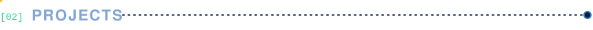

<a href="https://github.com/fouad3966/Smart-Assistive-Home-System"></a>

<b>How the capstone fits together</b> (architecture & mobile app)

 

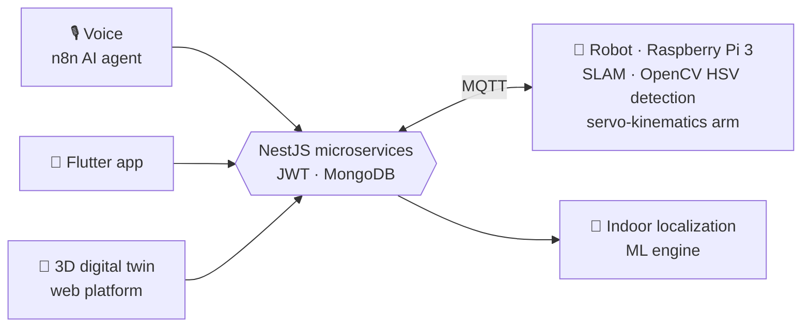

 

<b>Mobile Control & Real-time Telemetry (Flutter App)</b>

  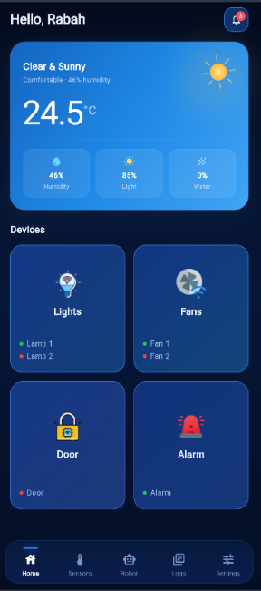&nbsp;
  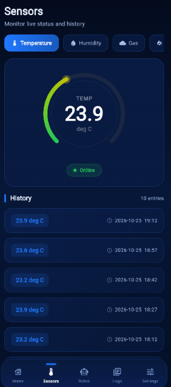&nbsp;
  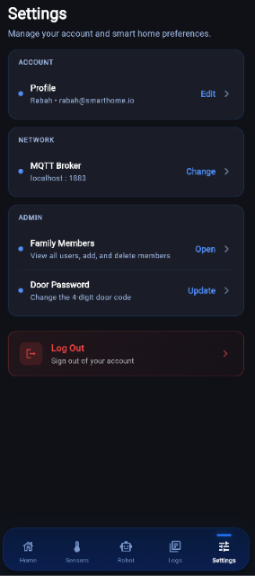

<a href="https://github.com/fouad3966/Thirduni---Designili"></a>

<b>How Designili connects AI, 3D and NLP</b> (architecture & previews)

 

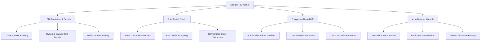

 

<b>Generative AI Darja Extraction & Real-time 3D Garment Simulation</b>

  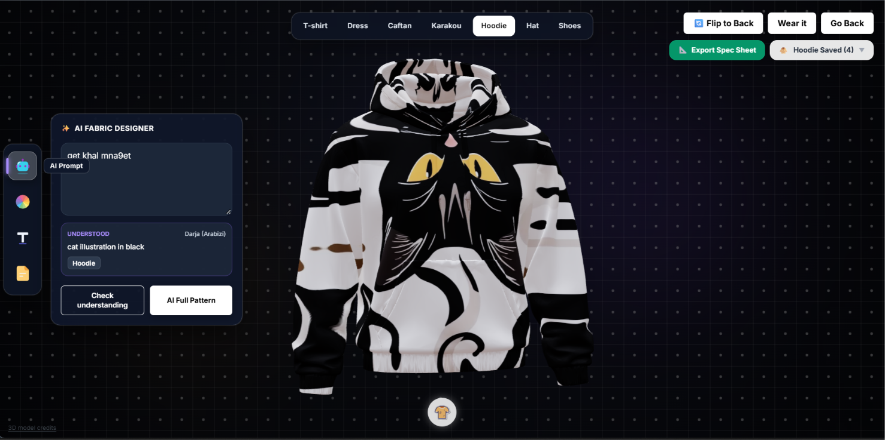&nbsp;
  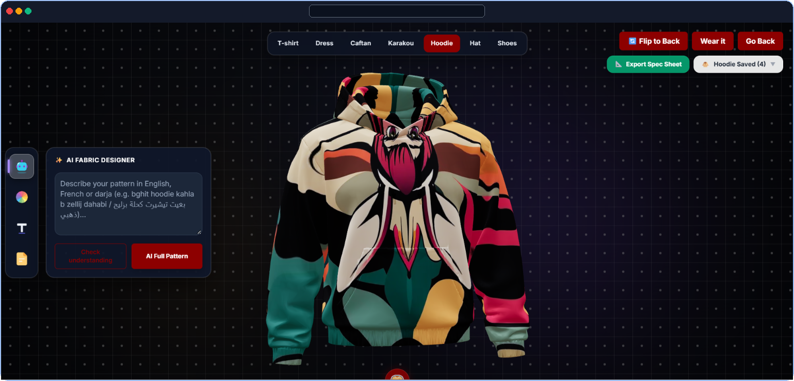

<a href="https://github.com/fouad3966/5G-SliceGuard"></a>

  

<table>
<tr>
<td width="50%" align="center">
  <a href="https://github.com/fouad3966/smart-home-embedded-nodes"></a> 
  
</td>
<td width="50%" align="center">
  <a href="https://github.com/fouad3966/Bearing_Simulation_PFE"></a> 
  
  

    
📸 <b>Preview Simulation UI</b>

     
    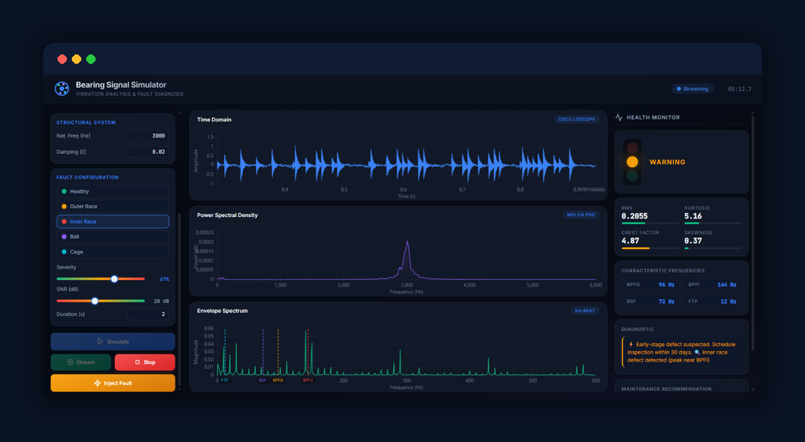
  

</td>
</tr>
<tr>
<td align="center">
  <a href="https://github.com/fouad3966/ML-pipeline-to-detect-fraudulent-credit-card-transactions"></a> 
  
</td>
<td align="center">
  <a href="https://github.com/fouad3966/Intelligent_Agent_for_Natural_Language_Database_Querying"></a> 
  
</td>
</tr>
</table>

<table>
<tr>
<td width="50%" align="center">
  <a href="https://github.com/fouad3966/HeurSup"></a> 
  
  

    
📸 <b>Preview Dashboard & Reports</b>

     
    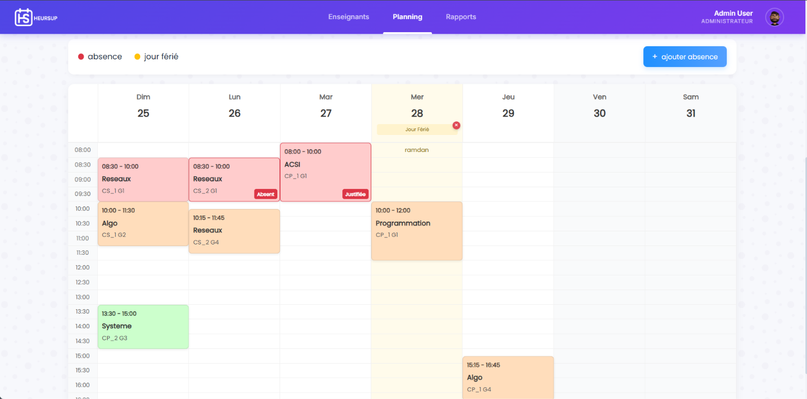&nbsp;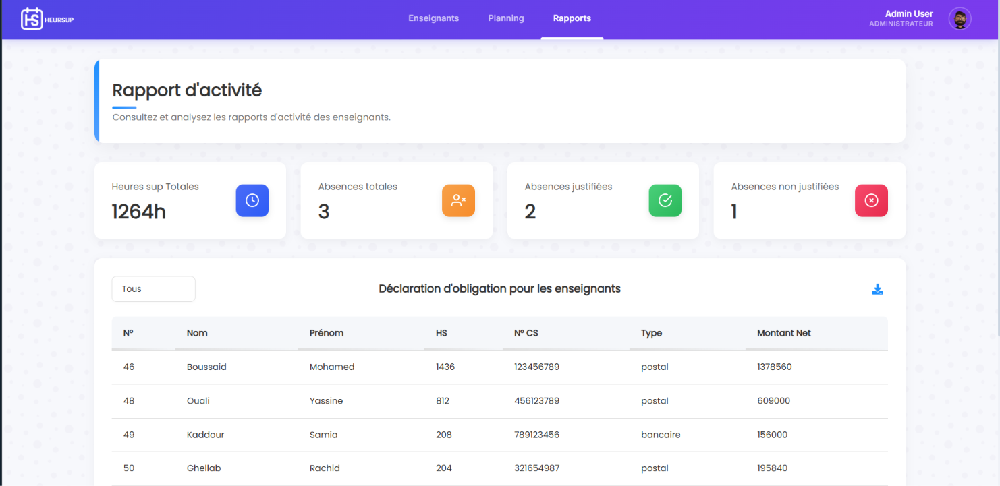
  

</td>
<td width="50%" align="center">
  <a href="https://github.com/fouad3966/apex-athletics"></a> 
  
  

    
📸 <b>Preview Web App & Programs</b>

     
    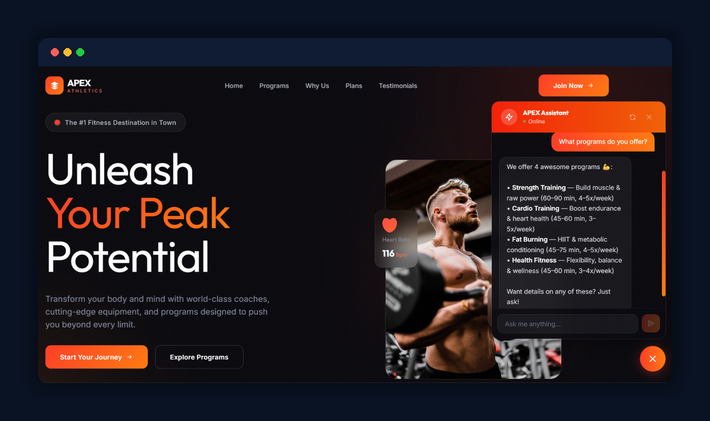&nbsp;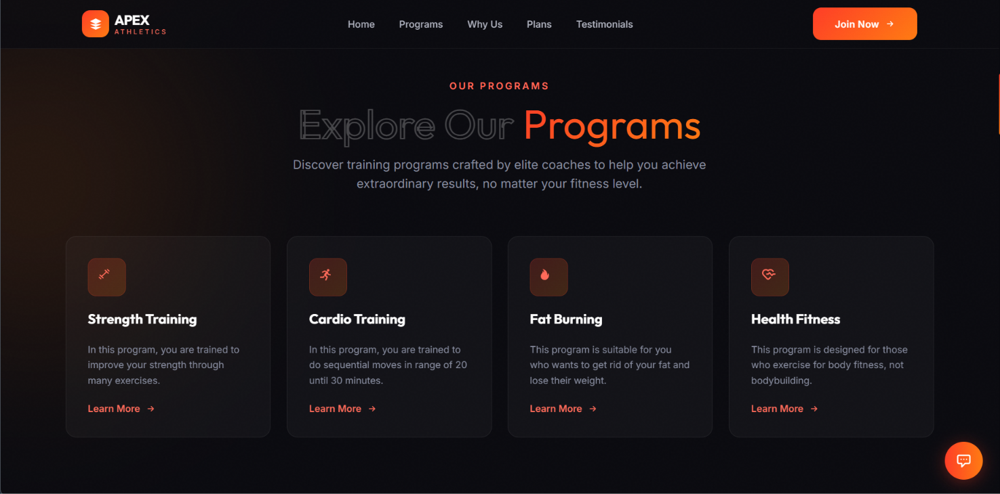
  

</td>
</tr>
<tr>
<td align="center">
  <a href="https://github.com/fouad3966/Ecom_Luxecart"></a> 
  
  

    
📸 <b>Preview Storefront & Admin Portal</b>

     
    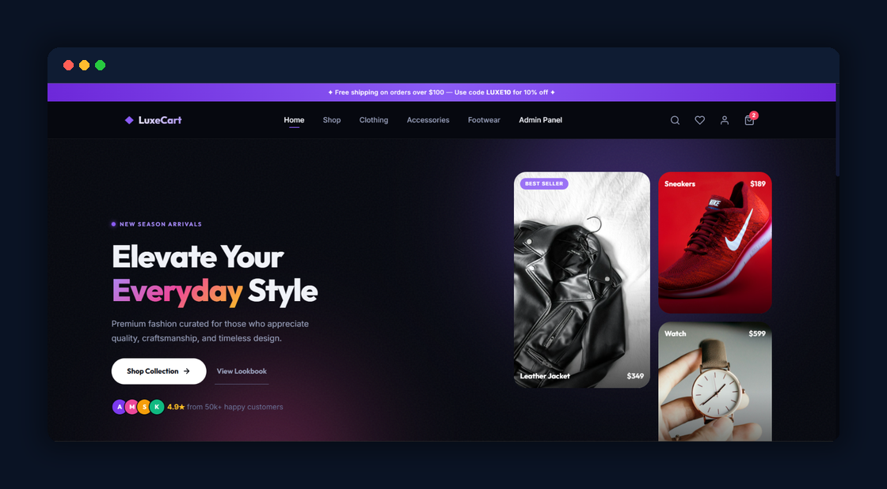&nbsp;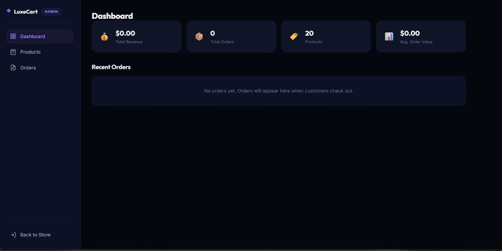
  

</td>
<td align="center">
  <a href="https://digitmake.net/"></a> 
  
  

    
📸 <b>Preview Platform Interface</b>

     
    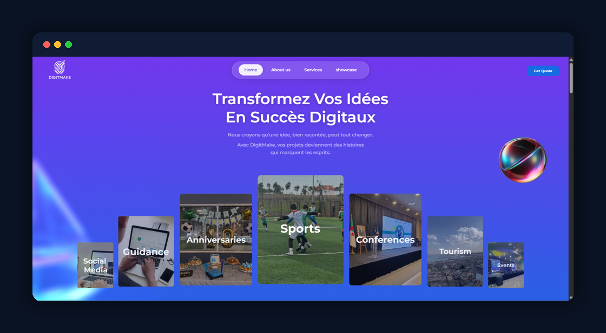
  

</td>
</tr>
<tr>
<td align="center">
  <a href="https://175-viral-templates-mx3y.vercel.app/"></a> 
  
  

    
📸 <b>Preview Checkout & Product</b>

     
    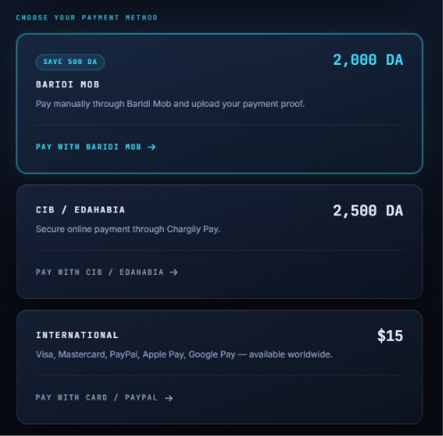
  

</td>
<td align="center">
  <a href="https://github.com/fouad3966/project-multimedia---QR-codes"></a> 
  
</td>
</tr>
</table>

<b>More projects</b> — data analytics, predictive modeling, networking

 

**Data Analytics & Business Intelligence**

| Project | Focus |
|---------|-------|
| [`DA-Churn-Prediction-for-StreamWorks-Media`](https://github.com/fouad3966/DA-Churn-Prediction-for-StreamWorks-Media) | Subscriber churn modeling with feature importance analysis and retention strategy recommendations |
| [`DA-Business-Intelligence-Dashboard-for-TechHub-Retail`](https://github.com/fouad3966/DA-Business-Intelligence-Dashboard-for-TechHub-Retail) | End-to-end BI dashboard: sales KPIs, inventory turnover, regional performance segmentation |
| [`DA-green-cart-sales-customer-insights`](https://github.com/fouad3966/DA-green-cart-sales-customer-insights) | Customer behavior analysis with cohort segmentation and CLV estimation |
| [`DA-customer-signup-analysis`](https://github.com/fouad3966/DA-customer-signup-analysis) | Funnel analysis and signup conversion optimization |

**Predictive Modeling & ML**

| Project | Focus |
|---------|-------|
| [`diabetes-ml-prediction`](https://github.com/fouad3966/diabetes-ml-prediction) | Comparative study: Logistic Regression, Random Forest, SVM with GridSearchCV hyperparameter tuning |
| [`Housing-Price-Prediction`](https://github.com/fouad3966/Housing-Price-Prediction) | Feature-engineered Random Forest pipeline for real estate price estimation |
| [`gtc-ml-project1-hotel-bookings`](https://github.com/fouad3966/gtc-ml-project1-hotel-bookings) | Full preprocessing pipeline: missing data imputation, feature encoding, class balancing |
| [`IoT-Network-Anomaly-Detection`](https://github.com/fouad3966/IoT-Network-Anomaly-Detection) | Anomaly detection models for IoT network traffic classification |

**Networking & Utilities**

| Project | Focus |
|---------|-------|
| [`TCP-Client-Server`](https://github.com/fouad3966/TCP-Client-Server) | Socket programming with a Gradio-based interactive interface |
| [`2CS_S2_Modules_Revision`](https://github.com/fouad3966/2CS_S2_Modules_Revision) | Collaborative revision guides for ESI-SBA students |

 

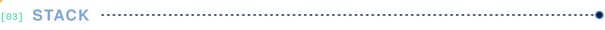

| Year | Milestone | Highlights |
|:----:|-----------|------------|
| **2020** | Algerian Youth Leadership Program | First cross-border collaboration experience |
| **2021** | Lycée Technique, Algeria | Technical Maths baccalauréat — **18.27/20**, top of class |
| **2021 →** | ESI-SBA | Engineering degree in AI, Systems, Networks and OS |
| **2023–24** | GDSC ESI-SBA · Vice President | Organized 4 events for 200+ participants, grew membership ~15% |
| **2024** | University of Montevallo, USA | UGRAD exchange semester — **GPA 3.75**, Dean's List, IT helpdesk |
| **2025** | Algérie Télécom / SONATRACH | FTTH deployment, MSAN configuration, VLANs, OTDR, firewall migration |
| **2025** | GTC — ML Track | 60-hour intensive: end-to-end financial transaction anomaly detection pipeline |
| **2025** | Designili 3D Studio · Thirduni | Fashion engineering platform: generative AI, 3D simulation, Darja NLP |
| **2026** | Smart-Assistive-Home-System | Lead developer & architect: home automation + robot + digital twin |
| **Now** | _Open to opportunities_ | Seeking research internships and applied engineering positions |

 

  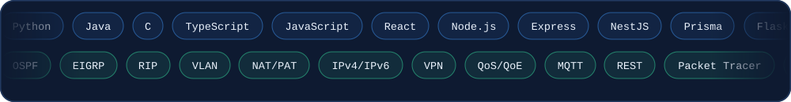

 

<!-- ═══════════════  PROGRAMMING LANGUAGES  ═══════════════ -->
<h3>💻 Programming Languages</h3>

<table>
<tr>
<td align="center" width="96"> <b>Python</b></td>
<td align="center" width="96"> <b>Java</b></td>
<td align="center" width="96"> <b>C</b></td>
<td align="center" width="96"> <b>JavaScript</b></td>
<td align="center" width="96"> <b>TypeScript</b></td>
<td align="center" width="96"> <b>HTML</b></td>
<td align="center" width="96"> <b>CSS</b></td>
<td align="center" width="96"> <b>SQL</b></td>
<td align="center" width="96"> <b>Bash</b></td>
</tr>
</table>

<!-- ═══════════════  WEB & BACKEND  ═══════════════ -->
<h3>🌐 Web & Backend</h3>

<table>
<tr>
<td align="center" width="96"> <b>React</b></td>
<td align="center" width="96"> <b>Next.js</b></td>
<td align="center" width="96"> <b>Node.js</b></td>
<td align="center" width="96"> <b>Express</b></td>
<td align="center" width="96"> <b>NestJS</b></td>
<td align="center" width="96"> <b>Prisma</b></td>
<td align="center" width="96"> <b>Flask</b></td>
<td align="center" width="96"> <b>Flutter</b></td>
</tr>
<tr>
<td align="center" width="96"> <b>GraphQL</b></td>
<td colspan="7"><code>REST APIs</code> <code>Microservices</code> <code>JWT Authentication</code></td>
</tr>
</table>

<!-- ═══════════════  DATABASES  ═══════════════ -->
<h3>🗄️ Databases</h3>

<table>
<tr>
<td align="center" width="96"> <b>PostgreSQL</b></td>
<td align="center" width="96"> <b>MongoDB</b></td>
<td align="center" width="96"> <b>SQLite</b></td>
<td align="center" width="96"> <b>Cassandra</b></td>
<td align="center" width="96"> <b>Oracle DB</b></td>
</tr>
</table>

<!-- ═══════════════  AI / ML & DATA SCIENCE  ═══════════════ -->
<h3>🤖 AI, Machine Learning & Data Science</h3>

<table>
<tr>
<td align="center" width="96"> <b>TensorFlow</b></td>
<td align="center" width="96"> <b>PyTorch</b></td>
<td align="center" width="96"> <b>scikit-learn</b></td>
<td align="center" width="96"> <b>OpenCV</b></td>
</tr>
<tr>
<td align="center" width="96"> <b>Pandas</b></td>
<td align="center" width="96"> <b>NumPy</b></td>
<td align="center" width="96"> <b>Matplotlib</b></td>
<td align="center" width="96"> <b>Streamlit</b></td>
</tr>
<tr>
<td colspan="4"><code>Data Preprocessing</code> <code>Feature Engineering</code> <code>Exploratory Data Analysis</code> <code>Supervised & Unsupervised Learning</code> <code>Model Training & Evaluation</code> <code>Model Optimization</code> <code>Anomaly Detection</code> <code>Gradient Boosting</code> <code>Ensemble Methods</code></td>
</tr>
</table>

<!-- ═══════════════  BI, AUTOMATION & LOW-CODE  ═══════════════ -->
<h3>📊 BI, Automation & Productivity</h3>

<table>
<tr>
<td align="center" width="96"> <b>Power BI</b></td>
<td align="center" width="96"> <b>Excel</b></td>
<td align="center" width="96"> <b>n8n</b></td>
<td align="center" width="96"> <b>Outlook</b></td>
<td align="center" width="96"> <b>Teams</b></td>
<td align="center" width="96"> <b>SharePoint</b></td>
<td align="center" width="96"> <b>PowerPoint</b></td>
</tr>
<tr>
<td colspan="7"><code>Dashboards</code> <code>Data Cleaning & Analysis</code> <code>Reporting</code> <code>Workflow Automation</code></td>
</tr>
</table>

<!-- ═══════════════  DEVOPS & TOOLS  ═══════════════ -->
<h3>🛠️ DevOps, Tools & OS</h3>

<table>
<tr>
<td align="center" width="96"> <b>Linux</b></td>
<td align="center" width="96"> <b>Docker</b></td>
<td align="center" width="96"> <b>Git</b></td>
<td align="center" width="96"> <b>GitHub</b></td>
<td align="center" width="96"> <b>Raspberry Pi</b></td>
</tr>
</table>

<!-- ═══════════════  NETWORKING  ═══════════════ -->
<h3>🌍 Networking & Infrastructure</h3>

<table>
<tr>
<td><b>Routing & Switching</b></td>
<td><code>OSPF</code> <code>EIGRP</code> <code>RIP</code> <code>Static & Dynamic Routing</code> <code>VLAN</code> <code>NAT/PAT</code> <code>IPv4/IPv6</code> <code>TCP/IP</code> <code>VPN</code> <code>QoS/QoE</code></td>
</tr>
<tr>
<td><b>Protocols & IoT</b></td>
<td><code>MQTT</code> <code>REST APIs</code> <code>Network Monitoring</code> <code>FTTH</code> <code>MSAN</code> <code>OTDR</code></td>
</tr>
<tr>
<td><b>Tools</b></td>
<td><code>Cisco Packet Tracer</code> <code>GNS3</code> <code>Wireshark</code></td>
</tr>
</table>

<!-- ═══════════════  DESIGN & MEDIA  ═══════════════ -->
<h3>🎨 Design & Media</h3>

<table>
<tr>
<td align="center" width="96"> <b>Figma</b></td>
<td align="center" width="96"> <b>Illustrator</b></td>
<td align="center" width="96"> <b>Premiere Pro</b></td>
<td align="center" width="96"> <b>After Effects</b></td>
<td align="center" width="96"> <b>CapCut</b></td>
</tr>
</table>

<!-- ═══════════════  OPTIMIZATION & MODELING  ═══════════════ -->
<h3>📐 Optimization & Modeling</h3>

> <code>Operations Research</code> <code>Decision Support</code> <code>Algorithm Design</code> <code>Data-Driven Modeling</code> <code>Heuristic Methods</code>

<!-- ═══════════════  SOFT SKILLS  ═══════════════ -->
<h3>🗣️ Soft Skills</h3>

> Leadership · Public Speaking · Event Organization · Cross-Cultural Teamwork · Problem Solving · Communication · Fast Learner

 

<!-- ═══════════════  CERTIFICATIONS  ═══════════════ -->

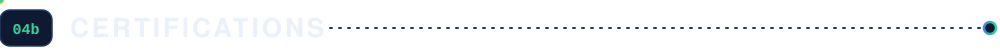

<table>
<tr>
<td width="70" align="center">📜</td>
<td>
  <b>Data Cleaning</b> — Certificate of Completion 
  📌 <b>Kaggle</b> · September 2025 
  
</td>
</tr>
<tr>
<td width="70" align="center">🧠</td>
<td>
  <b>Getting Started with Deep Learning</b> — Certificate of Competency 
  📌 <b>NVIDIA Deep Learning Institute</b> · September 2025 
  
</td>
</tr>
<tr>
<td width="70" align="center">🏅</td>
<td>
  <b>Machine Learning Track</b> — Certificate of Training 
  📌 <b>GTC (Global Tech Community)</b> · 2025 
  
</td>
</tr>
</table>

 

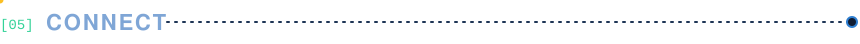

- 🤖 **Finalist**, First Global Robotics Competition, Switzerland (2022)
- 🥉 **Bronze**, Grand Challenge Award, Team Algeria (2020)
- 🥈 **Silver**, National Mathematics Olympiad (2021)
- 🎤 **VP, Google Developers Student Club ESI-SBA**: 4 events, 200+ participants, membership up ~15%
- 🎬 **Video lead, Alphabit Club**: so my demos come with decent editing
- 🌍 **Global programs**: UGRAD, Algerian Youth Leadership Program, The Experiment Digital, Tatawwar, Dialogue Leaders

 

  
  

